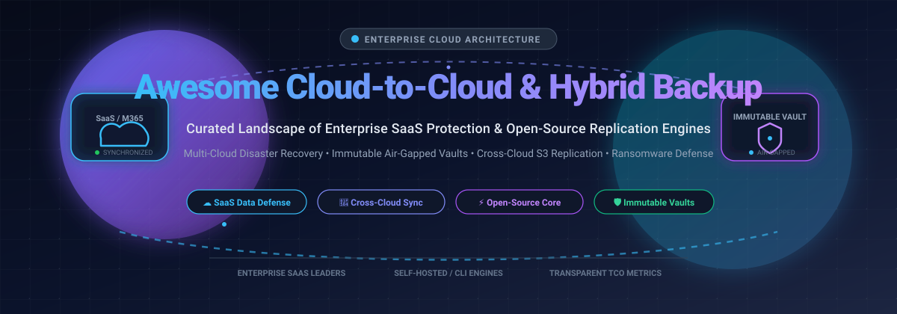

# 🚀 Awesome-Cloud-To-Cloud-Hybrid-Cloud-Backup

<p align="center">
  
</p>

<p align="center">
  <a href="https://github.com/ishandutta2007/Awesome-Awesome-Awesome"></a><a href="https://discord.gg/jc4xtF58Ve"></a>
  <a href="https://github.com/ishandutta2007/Awesome-Cloud-To-Cloud-Hybrid-Cloud-Backup/stargazers"></a>
  <a href="https://github.com/ishandutta2007/Awesome-Cloud-To-Cloud-Hybrid-Cloud-Backup/network/members"></a>
  <a href="https://github.com/ishandutta2007/Awesome-Cloud-To-Cloud-Hybrid-Cloud-Backup/issues"></a>
  <a href="https://github.com/ishandutta2007/Awesome-Cloud-To-Cloud-Hybrid-Cloud-Backup/blob/main/LICENSE"></a>
  <a href="https://github.com/ishandutta2007"></a>
</p>

---

## 🌐 Enterprise Cloud-to-Cloud & Hybrid Cloud Backup Ecosystem

> 🛡️ **Curated List of Enterprise SaaS Platforms & Open-Source Cloud Replication Engines**  
> *Targeted at Cloud Data Protection, SaaS Backup (M365, Google Workspace, Salesforce), Cross-Cloud Object Sync, Ransomware Resiliency & Hybrid Infrastructure Orchestration.*  
> **Last updated: March 2026**

This repository provides an authoritative, community-driven landscape of **SaaS data protection platforms** and **open-source backup engines** designed for modern **Cloud-to-Cloud (C2C)** and **Hybrid Cloud** architectures. Whether safeguarding business-critical SaaS tenants (Microsoft 365, Google Workspace, Salesforce, Slack) or orchestrating multi-cloud disaster recovery between AWS, Azure, GCP, and on-premises virtualization clusters, this directory breaks down verified pricing, free tier limits, company valuations, and technical capabilities.

---

## 📑 Table of Contents
- [📊 Sector Overview & Market Dynamics](#-sector-overview--market-dynamics)
- [☁️ SaaS & Enterprise Hosted Platforms](#️-saas--enterprise-hosted-platforms)
- [⚡ Open-Source GitHub Projects](#-open-source-github-projects)
- [🛠️ Architecture Blueprint: Building a Vendor-Neutral Hybrid Pipeline](#️-architecture-blueprint-building-a-vendor-neutral-hybrid-pipeline)
- [🤝 How to Contribute](#-how-to-contribute)
- [💖 Support & Sponsorship](#-support--sponsorship)
- [📈 Star History](#-star-history)
- [⚖️ Disclaimer](#️-disclaimer)

---

## 📊 Sector Overview & Market Dynamics

The global cloud backup and recovery market is estimated at **$7.1B – $7.9B in 2026**, expanding rapidly at a **CAGR of ~22.4% – 25.5%** toward exceeding $20B by 2030 as enterprises adapt to escalating ransomware threats, hybrid cloud adoption, and stringent cyber-resilience mandates (such as DORA, NIS2, and SEC cyber disclosures).

The sector is **moderately fragmented**, transitioning from legacy point-solution backup vendors into a concentrated tier of multi-billion-dollar enterprise cyber-resilience platforms (e.g., Veeam, Rubrik, Cohesity-Veritas, Commvault). While these top platform leaders capture the lion's share of Fortune 500 infrastructure deals via consolidated security suites, high customer switching friction, and broad multi-cloud coverage, significant fragmentation persists in specialized SaaS app protection, developer-centric database backup engines, and community-driven, vendor-neutral open-source tools.

---

## ☁️ SaaS & Enterprise Hosted Platforms

The table below lists category-defining SaaS and managed enterprise platforms, sorted descending by company size (Valuation / Market Capitalization / Annual Revenue).

| Product | Company Size (Valuation / Revenue) | Description | Starting Price | Free Tier / Trial Limits |
|---------|------------------------------------|-------------|----------------|--------------------------|
| **[Veeam](https://www.veeam.com/)** | **~$15.0B Valuation** (~$1.7B+ ARR; backed by TPG/Insight Partners) | Comprehensive backup & recovery platform for VMware, Hyper-V, AWS, Azure, Entra ID, and Microsoft 365. | **$1.08 / user / month** (Veeam Data Cloud for Entra ID) / **$2.63 / user / month** (Veeam Data Cloud Foundation for M365); self-managed VUL bundles from ~$1,200/year (10 workloads) | **Community Edition (Free Forever)**: permanently free for up to 10 workloads (VMs, cloud instances, or physical servers); 30-day fully functional trial for enterprise editions. |
| **[Cohesity DataProtect](https://www.cohesity.com/)** | **~$7.5B – $8.0B Valuation** (~$1.7B combined revenue with Veritas Data Protection) | Converged data security and AI-powered backup platform offering immutable snapshots, cyber vaulting, and instant recovery. | **$29,100 / year** (DataProtect as a Service entry baseline on cloud marketplaces, typically covering 10 Back-end Terabytes / BETB) | **30-day free trial**; trial access for DataProtect as a Service (DPaaS) provisioned via cloud marketplaces or partner evaluation. |
| **[Rubrik Security Cloud](https://www.rubrik.com/)** | **~$7.5B Market Cap** ($1.46B+ Subscription ARR; NYSE: RBRK) | Zero-trust data security and cyber recovery suite providing immutable backups, data threat analytics, and automated orchestration. | **$130.00 / BETB / month** (~$1,560 / Back-End TB / year for RSC Foundation Edition on 3-year commitment) | **Proof of Concept / SaaS Trial**: 30-day targeted trial capped at **500 users / 10 TB** for Microsoft 365 or **10 users / 500 GB** for Google Workspace. |
| **[Commvault Cloud](https://www.commvault.com/)** | **~$7.2B Market Cap** (~$1.25B TTM Revenue; NASDAQ: CVLT) | Enterprise-grade cyber resilience and SaaS backup platform supporting multi-cloud, databases, and collaboration apps. | **$1.70 / user / month** (SaaS Microsoft 365 protection) or **$58.50 / TB / month** (file and object storage protection) | **30-day free trial**; includes multi-workload backup & rapid recovery testing without requiring a credit card. |
| **[Datto SaaS Protection](https://www.datto.com/)** | **$6.2B Acquisition Valuation** (Acquired by Kaseya in 2022) | Cloud-to-cloud backup engineered for MSPs protecting Microsoft 365 and Google Workspace with independent cloud storage. | **$1.50 / user / month** (Baseline MSP entry license for M365/Google Workspace seat protection) | **14-day to 30-day partner evaluation trial**; includes 3x daily automated backups and unlimited cloud storage per seat (recommends files <100 GB). |
| **[Acronis Cyber Protect](https://www.acronis.com/)** | **~$3.5B Valuation** (~$450M+ annual revenue; majority owned by EQT) | Integrated cyber protection platform combining backup, disaster recovery, anti-malware, and endpoint management. | **$85.00 / workstation / year** (Standard tier) or ~$2.00–$5.00 / user / month for M365 cloud backup | **30-day free trial**; full access across Standard & Advanced editions without requiring a credit card (restricted bootable media recovery). |
| **[Druva](https://www.druva.com/)** | **~$2.0B Valuation** (~$200M+ SaaS ARR) | Cloud-native data protection with agentless backup, global deduplication, and automated cloud DR across M365, Google Workspace, endpoints, and cloud workloads. | **$8.00 / user / month** (Endpoint / SaaS starting tier); Enterprise Workload consumption begins at 1 Druva Credit (~1 TB compressed & deduped data / month) | **30-day free trial**; covers up to 1 TB protected data and full feature testing without upfront credit card requirements. |
| **[Carbonite](https://www.carbonite.com/)** | **$1.42B Acquisition Valuation** (Acquired by OpenText in 2019) | Automated endpoint, computer, and hybrid server cloud backup solution for individuals, workstations, and distributed teams. | **$95.99 / computer / year** (Carbonite Safe Basic; ~$8.00/month); Business Core starts at **$287.99 / year** for 25 computers & 250 GB | **15-day free trial** for Personal Safe (single computer, unlimited backup, data held 15 days post-expiration); **30-day free trial** for Business Safe Pro (up to 25 computers). |
| **[Backblaze B2](https://www.backblaze.com/)** | **~$550M Market Cap** (~$150M TTM Revenue; NASDAQ: BLZE) | High-performance, low-cost S3-compatible cloud object storage built as an enterprise backup destination for Restic, Kopia, and Duplicati. | **$6.95 / TB / month** ($0.00695/GB/month; additional egress beyond 3x allowance at $0.01/GB) | **Free Forever Tier**: First **10 GB** object storage free forever, free downloads/egress up to 3x monthly storage volume, and 2,500 free daily Class D API calls (no credit card required). |
| **[HYCU](https://www.hycu.com/)** | **~$300M – $500M Est. Valuation** (~$50M+ ARR; backed by Bain Capital) | Specialized multi-cloud and SaaS data protection platform (R-Cloud) defending 100+ cloud services and databases. | **$1.20 / user / year** (Baseline per-user SaaS add-on protection) or ~$30.00 / VM / month for hybrid infrastructure workloads | **14-day free trial** (standard for R-Cloud / Azure with zero software fees); Starter Bundle trial caps environments at **up to 50 VMs, 10 TB protected data, and 100 SaaS users**. |

---

## ⚡ Open-Source GitHub Projects

Open-source backup tools provide transparent, auditable, vendor-neutral data protection without recurring per-seat fees or storage egress lock-in. Sorted descending by GitHub stargazers count:

| Project | GitHub Stars | Primary Language | Description | Key Capabilities |
|---------|--------------|------------------|-------------|------------------|
| **[Rclone](https://github.com/rclone/rclone)** | [](https://github.com/rclone/rclone/stargazers) | Go | The Swiss army knife of cloud storage sync and migration. Synchronizes files across 70+ cloud providers (S3, B2, Google Cloud, Azure, SFTP, WebDAV). | Multi-cloud replication, bandwidth throttling, server-side copy, crypt backend |
| **[Restic](https://github.com/restic/restic)** | [](https://github.com/restic/restic/stargazers) | Go | Fast, secure, deduplicated backup utility. Operates with client-side cryptography and supports local disk, S3, Backblaze B2, Azure Blob, GCS, and SFTP. | Content-defined chunking deduplication, AES-256 encryption, snapshot versioning |
| **[Duplicati](https://github.com/duplicati/duplicati)** | [](https://github.com/duplicati/duplicati/stargazers) | C# | User-friendly backup engine with web-based management UI and scheduled automation. Compresses, encrypts, and uploads incremental backups to cloud targets. | AES-256 encryption, Web UI, incremental block backups, cross-cloud targets |
| **[Kopia](https://github.com/kopia/kopia)** | [](https://github.com/kopia/kopia/stargazers) | Go | Fast and secure open-source backup tool featuring content-addressable storage, snapshot management, end-to-end encryption, and zero-knowledge architecture. | GUI and CLI, snapshot retention policies, multi-cloud repository sync |
| **[BorgBackup](https://github.com/borgbackup/borg)** | [](https://github.com/borgbackup/borg/stargazers) | Python / C | Deduplicating archiver with authenticated encryption and compression. Battle-tested standard for Linux server and hybrid enterprise storage backups. | Chunk deduplication, authenticated encryption, SSH transport, data integrity verification |
| **[Velero](https://github.com/vmware-tanzu/velero)** | [](https://github.com/vmware-tanzu/velero/stargazers) | Go | The de facto standard for Kubernetes cluster backup, migration, and disaster recovery. Captures cluster state resources and persistent storage volumes. | Volume snapshots (EBS, Azure Disk, GCE PD), CSI support, multi-cluster disaster recovery |
| **[Bup](https://github.com/bup/bup)** | [](https://github.com/bup/bup/stargazers) | Python / C | Highly efficient backup system based on the Git packfile format, engineered to handle multi-terabyte virtual machine disk images and raw block files. | Rolling checksum deduplication, Git packfile storage, split sub-archives |
| **[Duplicacy](https://github.com/gilbertchen/duplicacy)** | [](https://github.com/gilbertchen/duplicacy/stargazers) | Go | Next-generation cloud backup tool based on lock-free deduplication, allowing multiple clients to back up to the same cloud storage without coordination. | Lock-free deduplication, client-side encryption, high concurrency |
| **[WAL-G](https://github.com/wal-g/wal-g)** | [](https://github.com/wal-g/wal-g/stargazers) | Go | High-throughput archival and database restoration tool for the cloud. Supports PostgreSQL, MySQL/MariaDB, MongoDB, and Redis with differential compression. | Continuous WAL archiving, point-in-time recovery (PITR), multi-cloud storage support |
| **[Docker Volume Backup](https://github.com/offen/docker-volume-backup)** | [](https://github.com/offen/docker-volume-backup/stargazers) | Shell / Docker | Containerized backup agent that backs up Docker volumes locally or directly to AWS S3, WebDAV, Azure Blob Storage, Dropbox, Google Drive, or SSH endpoints. | Automated container stop/start, cron schedules, cloud upload, retention pruning |
| **[GoBackup](https://github.com/gobackup/gobackup)** | [](https://github.com/gobackup/gobackup/stargazers) | Go | Lightweight CLI utility to back up databases (PostgreSQL, MySQL, SQLite, MongoDB, Redis) and configuration files directly to cloud storage destinations. | Multi-database dumps, S3/B2/GCS/Azure targets, scheduled daemon, Discord/Slack webhooks |
| **[Slackdump](https://github.com/rusq/slackdump)** | [](https://github.com/rusq/slackdump/stargazers) | Go | SaaS data extraction and backup tool designed to export public/private Slack messages, threads, files, and users locally and to cloud storage targets. | SaaS data portability, incremental exports, message archive formatting |
| **[pgBackWeb](https://github.com/eduardolat/pgbackweb)** | [](https://github.com/eduardolat/pgbackweb/stargazers) | Go / Vue | Modern, self-hosted web interface and orchestrator for PostgreSQL database backups with automated scheduling and S3-compatible cloud replication. | Web UI dashboard, automated cron schedules, instant one-click restores, multi-bucket S3 sync |
| **[Ghorg](https://github.com/gabrie30/ghorg)** | [](https://github.com/gabrie30/ghorg/stargazers) | Go | Fast CLI utility to clone, mirror, and back up entire GitHub, GitLab, Bitbucket, or Gitea organizations and user accounts into local or cloud archives. | Multi-platform VCS backup, org/user mass clones, wiki & issue metadata extraction |

---

## 🛠️ Architecture Blueprint: Building a Vendor-Neutral Hybrid Pipeline

By combining modular open-source components with low-cost object storage, engineering teams can build resilient, zero-lock-in backup pipelines:

```
[On-Premises Servers / VMs / K8s]  ───▶  [Restic / Kopia / Velero Engine]
                                                     │
                                                     ▼ (Client-Side Encryption)
                                         [Primary Cloud Target: Backblaze B2 / AWS S3]
                                                     │
                                                     ▼ (Automated Cross-Cloud Sync via Rclone)
                                         [Secondary Target: Wasabi / Azure Blob / GCS Vault]
```

- **Cost Benchmark**: Storing 1 TB on Backblaze B2 costs **$6.95/month (~$83.40/year)** with free egress up to 3x data volume, compared to $50–$200/month for proprietary managed suites.
- **Ransomware Defense**: Configure Object Lock (WORM - Write Once, Read Many) on target buckets to guarantee that backup archives cannot be deleted or modified by compromised credentials.

---

## 🤝 How to Contribute

Contributions are welcome from backup architects, DevOps practitioners, and open-source maintainers!

1. 🍴 Fork the repository.
2. 🌿 Create a descriptive feature branch (`git checkout -b add-backup-tool`).
3. 📝 Update `README.md` following the established table structure (link, company size/valuation or GitHub star badge, specific pricing, and factual technical description).
4. 🚀 Submit a pull request with an explanation of why the addition is valuable to cloud and hybrid backup engineers.

---

## 💖 Support & Sponsorship

If you find this curated resource helpful for your infrastructure, cloud architecture, or disaster recovery planning, please consider showing your support:

- ⭐ **Star this repository** to help others discover it on GitHub!
- 🍴 **Fork and share** with colleagues, DevOps teams, and sysadmins.
- ☕ **Buy a coffee & sponsor ongoing maintenance**: Support via the [GitHub Sponsor Dashboard](https://github.com/sponsors/ishandutta2007).

Your sponsorship directly funds ongoing research, benchmark verifications, and directory curation!

---

## 📈 Star History

[](https://www.star-history.com/#ishandutta2007/Awesome-Cloud-To-Cloud-Hybrid-Cloud-Backup&type=date&legend=top-left)

---

## ⚖️ Disclaimer

- This is an independent, **community-curated** directory and does not constitute a formal commercial endorsement.
- Enterprise data protection requires defense-in-depth: enforce least-privilege API permissions, client-side encryption, air-gapped immutable vaults, and automated restore drill testing.
- SaaS and cloud infrastructure pricing fluctuates based on enterprise volume agreements, multi-year commitments, regional data transfer charges, and promotional tiers.
